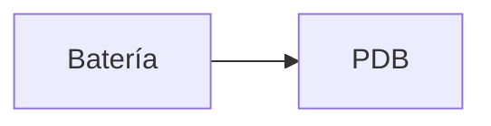

# Arquitectura

Texto con **negritas**, *cursivas*, `código` y un [enlace](https://vanttec.com).

## Interfaces entre módulos

| Módulo | Bus | Voltaje |
| --- | --- | --- |
| Jetson | Ethernet | 12 V |
| Pixhawk | UART | 5 V |

- [ ] Revisar el conector del sonar
- [x] Documentar la PDB

1. Primero
2. Segundo

- Viñeta con *énfasis*
- Otra viñeta

> Nota: los valores son de prueba.

---


[hoja-datos.pdf](/api/archivos/?proyecto=uuv&id=8d1e4b2a-5c3f-4a6e-b7d9-0e2f1a3c4b5d)

```pdf
archivo: 2f4b20ae-ad0a-48f2-9047-98aa57be8f55
titulo: Hoja de datos del regulador
```

```bom
referencia,descripcion,cantidad,costo_unitario
R1,Resistencia 10k,10,0.0032
C1,Capacitor 100nF,4,0.01
```

```diagrama
editor: excalidraw
fuente: 04a238d1-a144-47df-a5cf-00bacb6b56e0
svg: 0dec7eb3-19f8-43de-a025-d66a03eca897
titulo: Bloques de prueba
```



```python
print("los bloques de código normales siguen igual")
```

```text
Un enlace dentro de código no se toca: [x](/api/archivos/?proyecto=uuv\&id=00000000-0000-4000-8000-000000000000)
```
